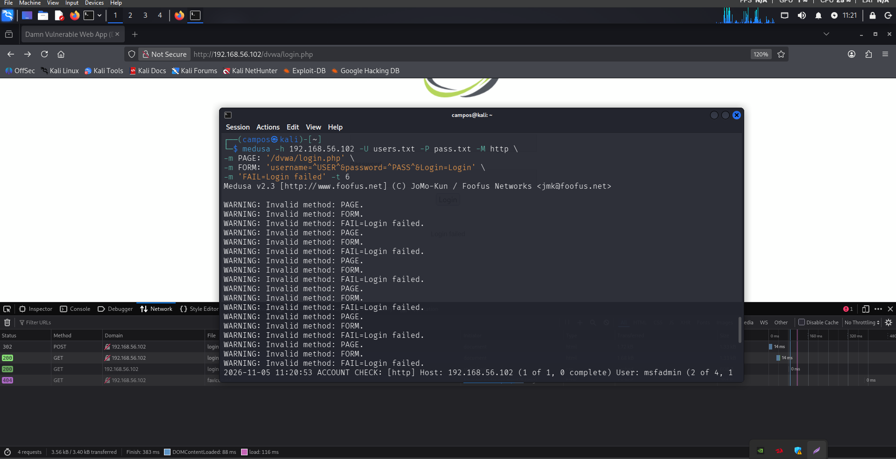
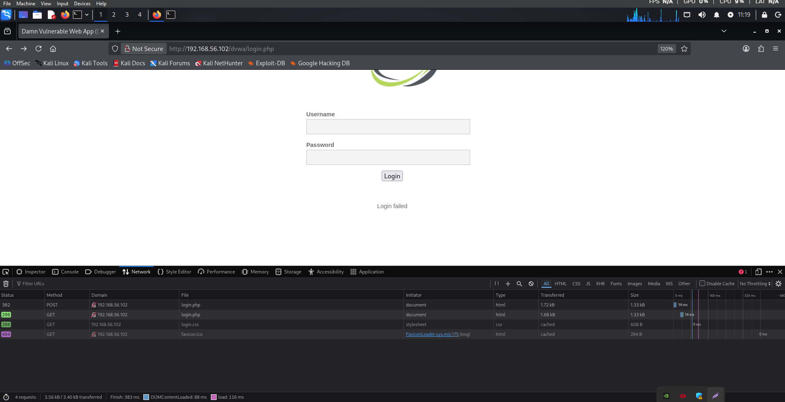
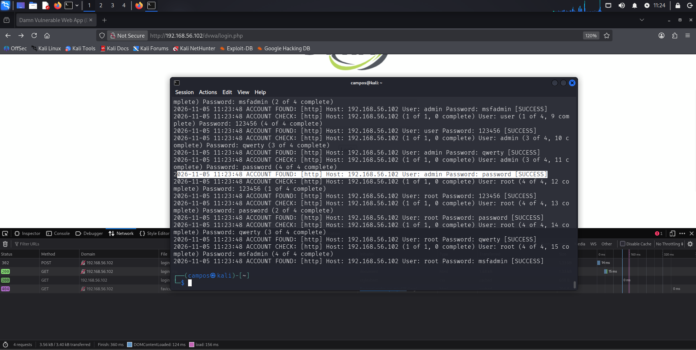
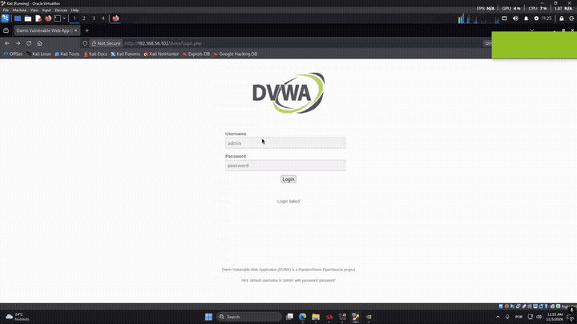

# Laboratório de Segurança: Kali Linux, Medusa e DVWA

Projeto educacional desenvolvido para documentar testes de autenticação em um ambiente de laboratório vulnerável, como parte de um desafio prático da DIO.

> **Uso ético:** testes realizados em ambiente de laboratório. Não reproduzir em sistemas de terceiros sem autorização explícita.

## Objetivo

Investigar o comportamento de tentativas de autenticação com a ferramenta Medusa, observar requisições HTTP no Firefox e discutir medidas de prevenção contra ataques de força bruta e reutilização de senhas.

## Ambiente e ferramentas

- **Sistema de testes:** Kali Linux em máquina virtual.
- **Alvo de laboratório:** DVWA (Damn Vulnerable Web Application), acessível no endereço privado `192.168.56.102/dvwa/login.php`.
- **Ferramentas:** Medusa e ferramentas de desenvolvedor do Firefox (aba Network).
- **Contexto:** prática controlada com aplicação intencionalmente vulnerável.

## Metodologia e evidências

### 1. Interface do DVWA e análise HTTP

A aplicação foi acessada pelo Firefox. A aba Network permitiu observar requisições à página de login, incluindo um `POST` com status `302`. Esse código indica redirecionamento, **não** comprova por si só autenticação bem-sucedida. Na interface também foi observada a mensagem `Login failed`.

### 2. Tentativa inicial com Medusa

Foi realizada uma tentativa de automatizar testes de autenticação HTTP com listas locais de usuários e senhas. A saída apresentou repetidamente `WARNING: Invalid method: PAGE`, `FORM` e `FAIL`, indicando problemas de interpretação dos parâmetros fornecidos ao módulo. Esta execução não é apresentada como comprovação de descoberta de credenciais.

### 3. Saída posterior da ferramenta

Em outra execução registrada, o Medusa apresentou diversas linhas `ACCOUNT FOUND [http] ... [SUCCESS]` para diferentes combinações de usuário e senha. Como várias combinações distintas aparecem como sucesso, o resultado **precisa de validação independente**: a detecção pode estar associada à interpretação incorreta das respostas da aplicação. Portanto, as mensagens são documentadas como **sucessos reportados pelo Medusa**, não como prova conclusiva de acesso autenticado.

### 4. Demonstração visual

O GIF abaixo registra uma interação com a interface de login. Deve ser interpretado em conjunto com as capturas e não como validação automática de todas as credenciais reportadas.

## Resultados e limitações

- O ambiente DVWA ficou acessível a partir do Kali Linux.
- Foram observadas requisições HTTP de autenticação no navegador.
- Uma execução do Medusa produziu avisos de parâmetros inválidos.
- Outra execução reportou combinações como `SUCCESS`, mas a multiplicidade de sucessos exige verificação adicional para descartar falsos positivos.
- Não foi demonstrada, nestas evidências, a confirmação independente de todas as credenciais reportadas nem a exploração de contas reais.

## Recomendações de mitigação

1. Aplicar autenticação multifator sempre que possível.
2. Usar senhas fortes e exclusivas e eliminar credenciais padrão.
3. Implementar limitação de tentativas, atrasos progressivos e controles contra automação.
4. Monitorar falhas e sucessos de login, criando alertas para padrões anômalos.
5. Evitar mensagens e comportamentos de autenticação que facilitem a enumeração de usuários.
6. Manter aplicações e dependências atualizadas e restringir o acesso às interfaces administrativas.

## Aprendizados

O laboratório permitiu praticar o uso do Kali Linux, observar o funcionamento de formulários HTTP, interpretar mensagens de ferramentas de auditoria e reconhecer a importância de validar resultados automatizados antes de classificá-los como vulnerabilidades confirmadas.

## Próximos passos

- Validar manualmente, no ambiente de laboratório, um resultado apontado pela ferramenta.
- Registrar as configurações de rede virtual e versões das ferramentas.
- Comparar o comportamento de autenticação antes e depois da aplicação de controles de proteção.

## Aviso

Este repositório é exclusivamente educacional. Os endereços mostrados são privados e pertencem ao contexto de laboratório apresentado nas evidências.
